# Pagewright

**Edit, convert and finish any PDF, right in your browser.**

A free online PDF editor with 26 tools: annotate, edit existing text, fill forms, sign, redact, organize pages, and convert to and from Word, Excel, PowerPoint, JPG and more. Your files never leave your device.

[](#quick-start)
[](#project-structure)
[](#features)
[](#privacy)
[](#license)

[Preview](#video-preview) · [Screenshots](#screenshots) · [Quick start](#quick-start) · [Features](#features) · [Usage](#usage) · [Limits](#limits)

[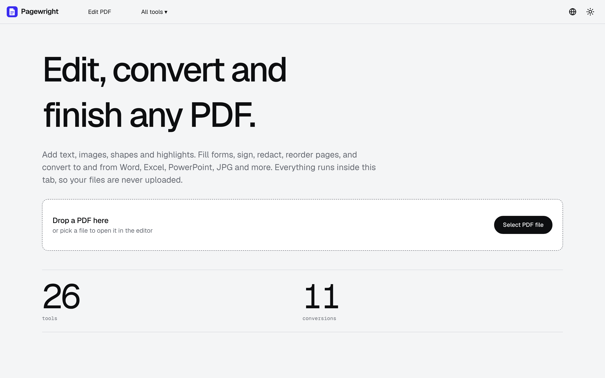](screenshots/home.png)

## Video preview

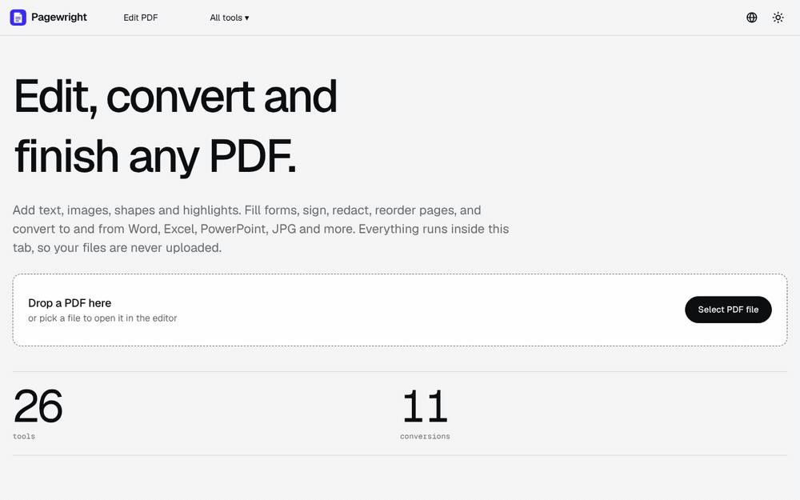

**Open a PDF, mark it up, then convert it to Word.**

## Screenshots

[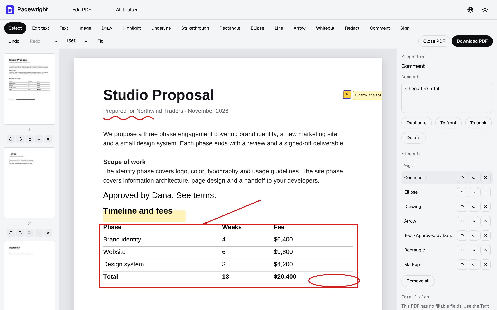](screenshots/editor.png)

**Text, highlights, shapes, arrows, drawings and comments. Comment text shows on the page and in the downloaded PDF.**

[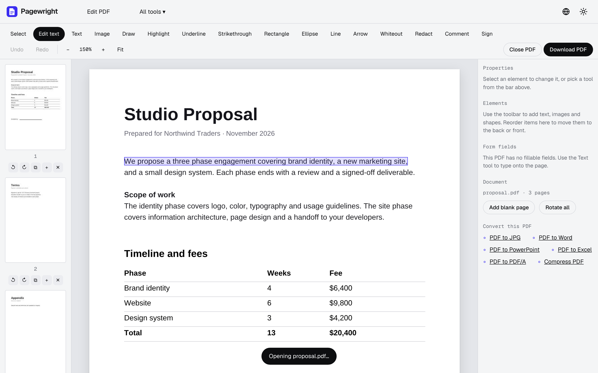](screenshots/edit-text.png)

**Edit text changes a line that is already in the PDF.**

[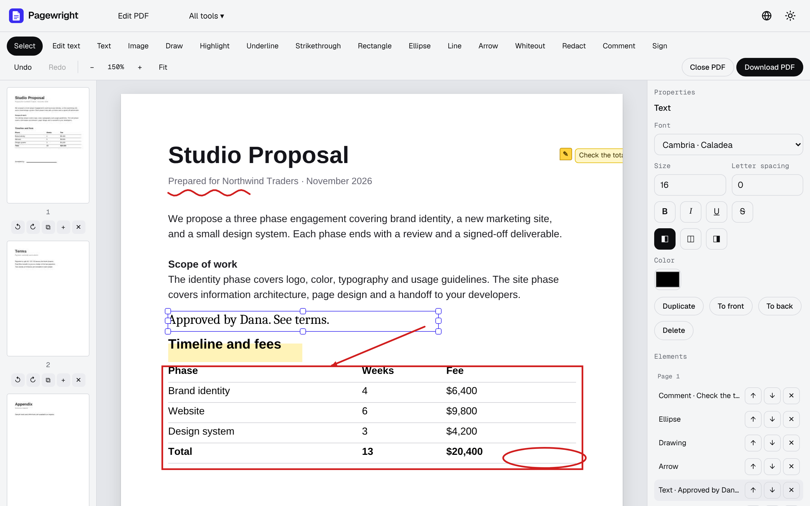](screenshots/fonts.png)

**More than 390 fonts, grouped as sans serif, serif, monospace, handwriting and display.**

[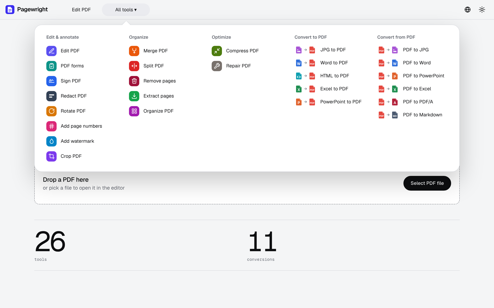](screenshots/menu.png)

**Hover All tools for a menu with a colored icon per tool. Conversions show the source file pointing to the target file.**

[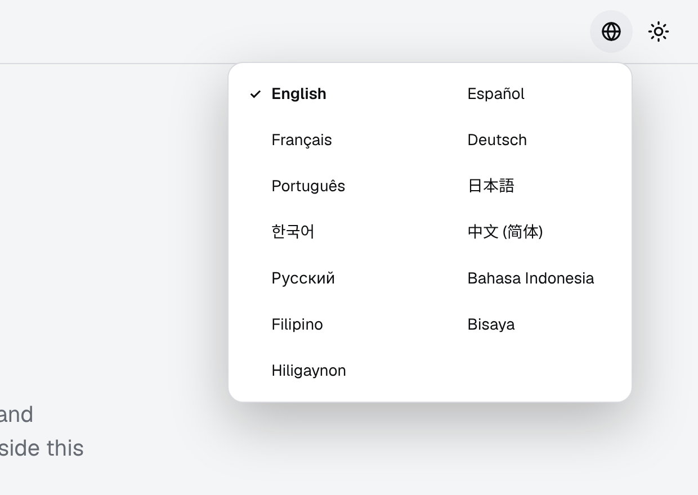](screenshots/languages.png)

**13 languages: English, Español, Français, Deutsch, Português, 日本語, 한국어, 中文 (简体), Русский, Bahasa Indonesia, Filipino, Bisaya and Hiligaynon. The home page fits on one screen in each, with the same layout in every language.**

[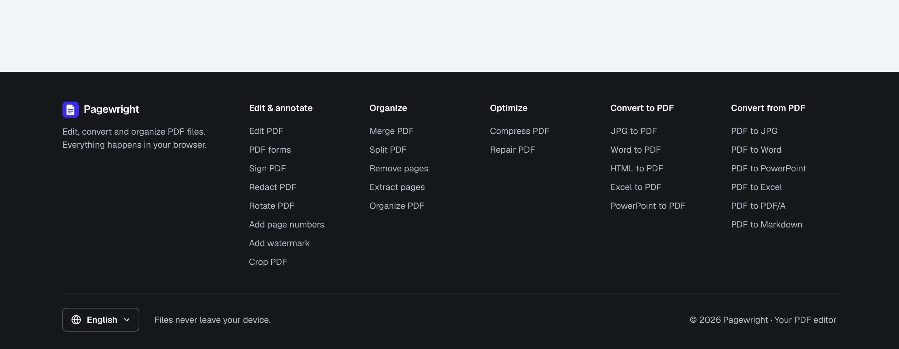](screenshots/footer.png)

**A footer lists every tool, with the language picker and a privacy note.**

[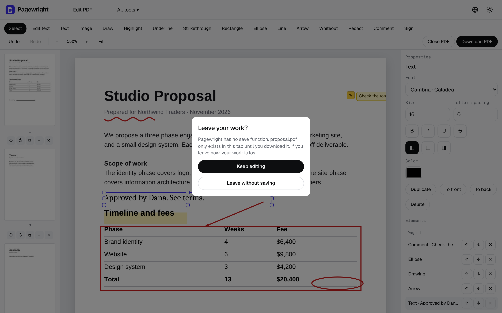](screenshots/leave-warning.png)

**Pagewright has no save function, so leaving a PDF you have not downloaded asks first.**

[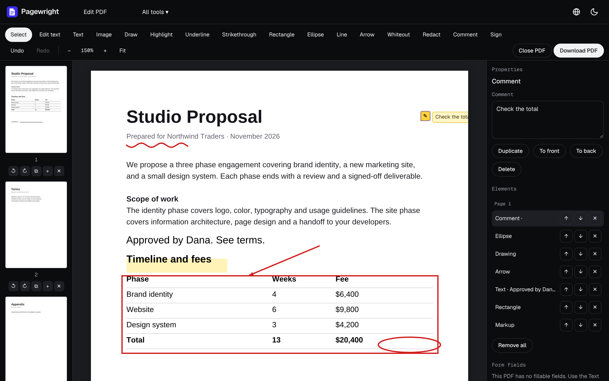](screenshots/editor-dark.png)

**The theme follows your system. The header button shows a sun in light mode and a moon in dark mode.**

[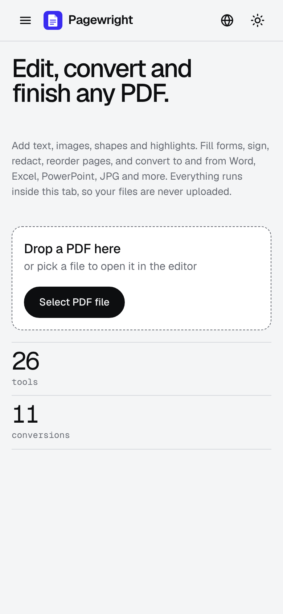](screenshots/mobile-home.png)
[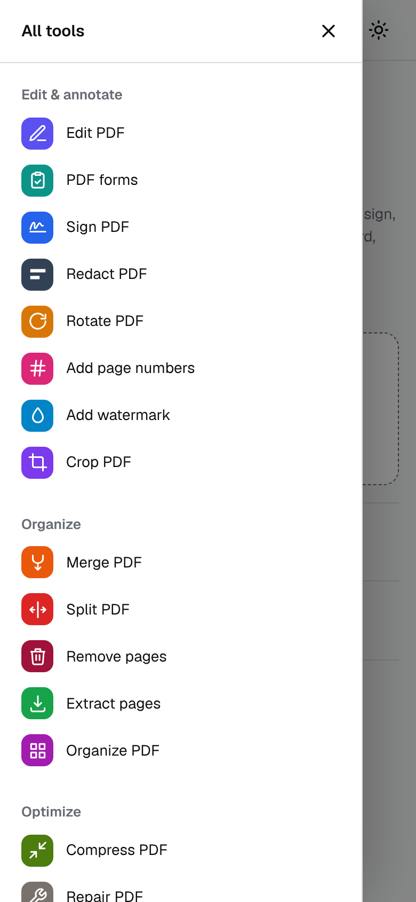](screenshots/mobile-menu.png)
[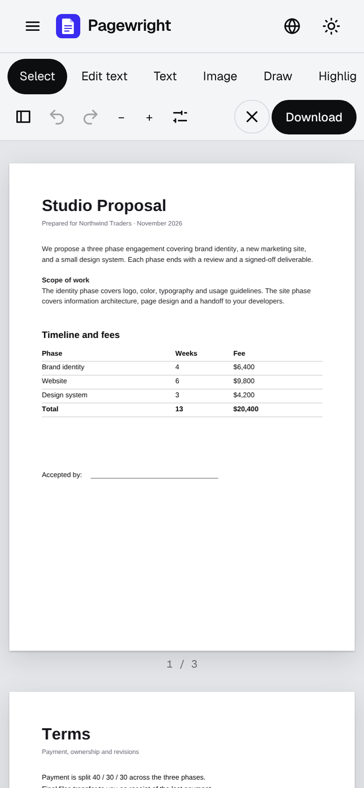](screenshots/mobile-editor.png)

**On a phone, a burger button opens the tool list, and the editor tools sit in one swipeable row.**

## Quick start

You need a modern browser and an internet connection, because the PDF libraries and fonts load from a CDN.

1. Download or clone this repository.
2. Open `index.html`. Keep `style.css`, `script.js` and `lang.js` in the same folder. The page links them with a `?v=` suffix. Change it when you update the files, so browsers load the new copies.

Or serve it locally with `python3 -m http.server 8080` and visit `http://localhost:8080`.

**Deploy on GitHub Pages:** push the folder to a repository, open **Settings → Pages**, choose **Deploy from a branch**, pick `main` and `/ (root)`, then **Save**.

## Features

- **Edit and annotate:** text, images, shapes, arrows, drawing, highlight, underline, strikethrough, comments, whiteout, redact, signatures and form filling, plus editing existing text
- **Text:** more than 390 fonts with size, bold, italic, underline, strikethrough, letter spacing, alignment and color
- **Organize:** thumbnails, reorder, rotate, duplicate, merge, split, remove and extract pages
- **Optimize:** compress, repair, rotate, page numbers, watermark, crop
- **Convert to PDF:** JPG, Word, PowerPoint, Excel, HTML
- **Convert from PDF:** JPG, Word, PowerPoint, Excel, PDF/A, Markdown
- **Interface:** light and dark themes, 13 languages, a phone layout, and a warning before you leave unsaved work

## Usage

| To do this | Go to | Then |
| --- | --- | --- |
| Edit a PDF | **Edit PDF** | Drop in a PDF, pick a tool, click the page, then **Download PDF** |
| Change existing text | **Edit text** | Click a line, type, then click outside the box |
| Sign | **Sign** | Draw, type or upload, then click the page |
| Combine files | **Merge PDF** | Add files, set the order, then run it |
| Convert | Any conversion tool | Select a file, then run it |
| Start over | **Close PDF** | Confirm, then pick a new file |

Shortcuts: `V` select, `T` text, `D` draw, `H` highlight, `R` `O` `L` `A` `N` for shapes and comments, `Ctrl/Cmd + Z` undo, `Delete` remove, `Esc` back to Select.

## Privacy

Everything runs in your browser. Pagewright never uploads a file. The only network requests are for the libraries and fonts listed below.

## Project structure

```
Pagewright/
├── index.html     # page markup
├── style.css      # styles and themes
├── script.js      # app logic
├── lang.js        # translations
├── screenshots/
├── gifs/
├── LICENSE
└── README.md
```

To add a tool, add a `T({...})` entry in `script.js` with an `id`, `group`, `name`, `desc` and a `run({files, o, progress})` function that returns `[{name, data}]`. It appears on the home page and in the menu automatically.

## Tech stack

[pdf.js](https://mozilla.github.io/pdf.js/) for rendering, [pdf-lib](https://pdf-lib.js.org/) and [fontkit](https://github.com/Hopding/fontkit) for editing and fonts, [Fontsource](https://fontsource.org/) font files, [mammoth](https://github.com/mwilliamson/mammoth.js), [SheetJS](https://sheetjs.com/), [JSZip](https://stuk.github.io/jszip/), [PptxGenJS](https://gitbrent.github.io/PptxGenJS/) and [html2canvas](https://html2canvas.hertzen.com/) for conversions.

## Limits

- Word, PowerPoint, HTML and Excel to PDF rebuild content in a simple layout. Themes, charts and animations are not kept.
- PDF to Word, PowerPoint and Excel rebuild text from the PDF. Scanned pages have no text to read.
- Microsoft fonts cannot be bundled, so names like Calibri use free look-alikes such as Carlito.
- Added text supports Latin characters only. A font that fails to load falls back to Helvetica.
- Not included: passwords, OCR, compare and AI features, which need a server.

## License

MIT. See [LICENSE](LICENSE).
